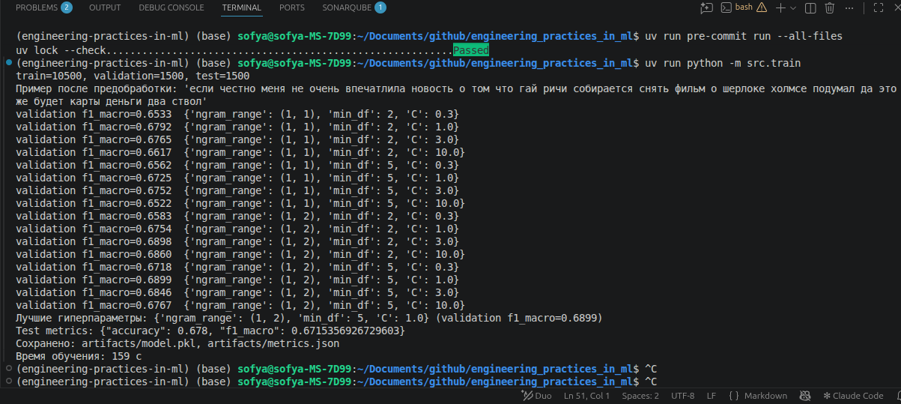
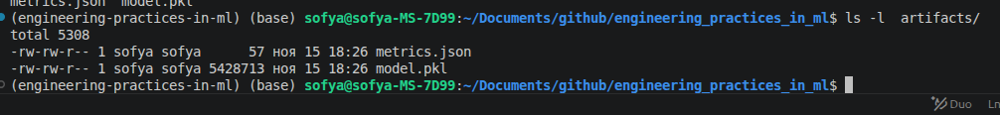

# Отчёт по ДЗ-1


## 1. Установка

```console
$ uv sync --locked
Resolved 42 packages
Checked 39 packages
```

## 2. Загрузка данных

```console
$ uv run python -m src.get_data
data/raw/train.jsonl: 10500 строк, 36672385 байт
data/raw/validation.jsonl: 1500 строк, 5331067 байт
data/raw/test.jsonl: 1500 строк, 5208896 байт
Данные сохранены в data/raw
```

Источник — `ai-forever/kinopoisk-sentiment-classification` (лицензия MIT), токен не требуется.
Скрипт удаляет `data/raw/`, загружает данные заново и проверяет наличие и непустоту всех файлов.

## 3. Проверка кода (Ruff + pre-commit)

### 3.1. Хуки находят реальные нарушения

```python
import os, sys
import json


def f( x ):
    y=1
    return x
```


Выход с кодом 1: Ruff исправил автоматически нарушения (неиспользуемые импорты, форматирование), и неиспользуемая переменная `y` требует ручного исправления.

### 3.2. Корректный код проходит


## 4. Обучение



`artifacts/metrics.json` (только метрики на test):

```json
{
  "accuracy": 0.678,
  "f1_macro": 0.6715356926729603
}
```

Артефакты:

```console
$ ls -la artifacts/
```


Гиперпараметры выбраны по validation (лучшее значение f1_macro = 0.6899);
test использовался один раз для итоговой оценки.
